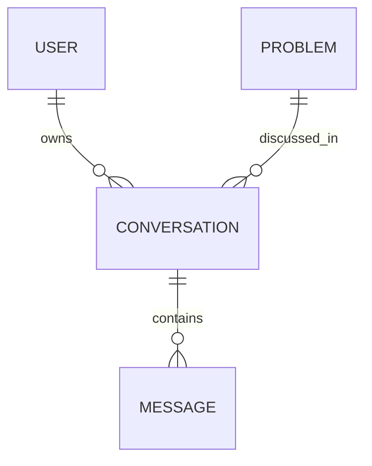

# Phase 4: problems and persistent conversations

## Scope

This phase adds two Django apps and one shared API utility module without new dependencies. JWT defaults, accounts APIs, health checks, and the Chrome extension are preserved. There are no Groq calls, external LeetCode requests, bookmarks, analytics, deployment, commits, or pushes.

## Database design



| Model | Fields and invariants |
| --- | --- |
| `problems.Problem` | ID, title (255), canonical URL (512, unique), slug (200, unique), statement (30,000), created/updated timestamps |
| `conversations.Conversation` | ID, owner FK to standard User, problem FK, language, private last-sequence counter, created/updated timestamps |
| `conversations.Message` | ID, conversation FK, role (`user` or `assistant`), content (8,000), positive sequence, created timestamp |

Unique URL and slug fields create indexes. Foreign keys are indexed by Django. Conversations have an `(owner, -updated_at, -id)` index for the owner-filtered recent list. Messages have a unique `(conversation, sequence)` constraint, which also supplies their ordered lookup index. Check constraints restrict languages, message roles, positive sequences, and nonempty content. Services additionally reject whitespace-only, oversized, and NUL-containing content; model field validators alone are not automatically enforced by bulk ORM writes.

Deleting a user cascades to their conversations. Deleting a conversation cascades to its messages. A referenced problem is protected from deletion; deleting one conversation leaves shared problem metadata and other users' conversations intact. Multiple conversations per user/problem/language are intentional, so a student can start a fresh session.

Migrations use Django's portable model operations and were run with local SQLite. PostgreSQL is the intended next database but has not been tested here.

## Problem identity and trust

`problems.validators.normalize_problem_url` validates URL syntax without network access. It accepts HTTP/HTTPS and only `leetcode.com` or `www.leetcode.com`; strips query strings and fragments; lowercases the slug; canonicalizes HTTPS, hostname, and trailing slash. Known page tabs (`description`, `editorial`, `solutions`, `submissions`) normalize to the base problem. Only default ports are accepted. Credentials, lookalike hosts, encoded path segments, backslashes, embedded whitespace/control characters, invalid slugs, and unsupported paths are rejected. Slugs use ASCII letters/digits separated by single hyphens.

For example, `http://www.leetcode.com/problems/TWO-SUM/description/?envId=1#example` becomes `https://leetcode.com/problems/two-sum/`.

The model's normal save path also canonicalizes the URL. Bulk updates/raw SQL bypass that Python behavior and must not be used to import unvalidated URLs. DB uniqueness is the final protection against duplicate canonical identities; `get_or_create` handles concurrent uniqueness conflicts through Django.

Problems are intentionally shared, not private notes. Any signed-in user can retrieve a problem by ID, but none of the API endpoints let clients update or delete shared metadata. The first valid submission wins. Later submissions return it unchanged. Title and statement are unverified client-supplied text; URL syntax does not establish that a problem exists. Do not submit private thoughts as statements. Moderation, verified imports, and correcting stale/problem-poisoned metadata need a separate trusted workflow later.

## API design

All new endpoints inherit JWT authentication and authenticated-access defaults. JSON responses use `Cache-Control: no-store`.

| Method | URL | Behavior |
| --- | --- | --- |
| POST | `/api/problems/` | `title`, `url`, `statement`; create (`201`) or reuse (`200`) a canonical problem |
| GET | `/api/problems/{id}/` | Retrieve shared metadata (`200` or `404`) |
| POST | `/api/conversations/` | `problem_id`, `language`; owner assigned from `request.user`; returns `201` |
| GET | `/api/conversations/` | Own conversations only; paginated, newest updated first, ID breaks ties |
| GET | `/api/conversations/{id}/` | Owned conversation with latest 50 messages, oldest-to-newest sequence; `messages_truncated` indicates older messages |
| DELETE | `/api/conversations/{id}/` | Delete owned conversation and messages (`204`) |
| GET | `/api/conversations/{id}/messages/` | All owned messages through 20-item pages, oldest first |

Lists use `{count, next, previous, results}`. Supply `?page=2` for the next page. No client-controlled page size is accepted. Ordinary page-number pagination can shift while conversations are updated; it does not promise a snapshot across requests. Message creation is not public: POST to the messages endpoint returns `405`. There are no conversation update endpoints.

This two-step problem-then-conversation design avoids repeating problem text on each session and keeps input schemas small. Canonical problem reuse uses POST because it can create a record, while GET by ID is read-only. Bounded embedded messages avoid returning arbitrarily large detail responses; the separate paginated endpoint gives access to the full stored history.

Supported languages match the extension choices: Python, Java, C++, JavaScript, TypeScript, C, C#, Go, Ruby, Swift, Kotlin, Rust, PHP, Scala. Send exact names.

Missing/invalid JWTs return `401`. Unowned and nonexistent conversations both return `404` for detail, messages, and delete. Invalid or unknown input fields return `400`. Clients cannot submit `owner`, `owner_id`, `messages`, `role`, `sequence`, or timestamps to create a conversation. Unsupported request media types return `415`; malformed JSON returns `400`; oversized write bodies return `413`; throttling returns `429` with `Retry-After`.

## Private message service

`conversations/services.py` exposes three trusted Python entry points:

```python
append_message(conversation_id=conversation.pk, owner=user,
               role="user", content="I am considering a hashmap.")
ordered_messages(conversation_id=conversation.pk, owner=user)
get_history(conversation_id=conversation.pk, owner=user,
            limit=10, max_characters=12000)
```

Both user and assistant roles are accepted only by trusted service callers. Every operation requires the expected owner and verifies the conversation belongs to them. No caller-supplied role is ever exposed through a public message-writing API. Future AI orchestration must derive the assistant role from its own code, not from HTTP data.

`append_message` validates content, enters `transaction.atomic`, increments the parent counter using a database `F` expression, updates its timestamp, and inserts a message with that sequence. The parent update is the first database operation in the transaction. This takes a write lock on SQLite and a row lock on PostgreSQL; it avoids relying on `select_for_update`, which does not lock rows on SQLite. Any insert failure rolls back both counter and timestamp. See Django's [database-side expressions and race conditions](https://docs.djangoproject.com/en/5.2/ref/models/expressions/#avoiding-race-conditions-using-f).

Messages use ascending sequence (then ID) as authoritative chronology, so timestamp ties cannot reorder messages. Treat messages as append-only and always use this service for writes. Direct ORM inserts can violate service assumptions even when DB constraints hold. Concurrent writers can encounter SQLite lock errors; these must propagate as failures, with bounded retry added by a future orchestration layer. No high-contention/multi-process benchmark or PostgreSQL concurrency test has been run.

`get_history` returns only `{role, content}` dictionaries for the most recent messages within both budgets, in chronological order. Defaults are 20 messages and 24,000 content characters. Overrides may lower but not exceed the configured ceilings. Whole messages are included; walking backward stops when the next message does not fit. If even the newest message cannot fit, history is empty. Truncation never deletes stored messages. Character counts are not tokenizer counts and do not include problem/system prompts; future Groq integration must budget those separately and decide whether turns should be grouped.

## Limits and settings

| Setting / rule | Default |
| --- | --- |
| `PROBLEM_REQUEST_RATE` | 60/minute per signed-in user |
| `CONVERSATION_REQUEST_RATE` | 120/minute per signed-in user |
| `API_MAX_BODY_BYTES` | 65,536 bytes for new write APIs |
| `HISTORY_MAX_MESSAGES` | 20 |
| `HISTORY_MAX_CHARACTERS` | 24,000 |
| API page size | 20, fixed |
| Embedded detail messages | latest 50, fixed |
| Message content | 8,000 characters, service limit |
| Problem title / statement | 255 / 30,000 characters |

`core/api.py` provides strict input checking, fixed-size pagination, and a JSON parser that reads at most the byte ceiling plus one byte before parsing. It bounds actual parsed body content instead of trusting Content-Length alone. This parser is only installed on the new APIs; existing auth behavior is unchanged. Server/proxy request limits are still necessary for transport-level protection. Django also [recommends limits in front of the application](https://docs.djangoproject.com/en/5.2/ref/settings/#data-upload-max-memory-size).

Scopes cover both reads and writes for each resource. Existing in-memory cache throttling is not a distributed quota system. Shared caching, infrastructure limits, total storage quotas, retention policy, and audit logging need future design. JSON text is untrusted content; any future frontend must render it safely and AI prompts must treat it as data.

## Verification and local use

From Windows PowerShell:

```powershell
Set-Location 'C:\Users\Shivangi Ahuja\Desktop\Student Buddy\backend'
.\.venv\Scripts\python.exe -m pip install -r requirements.txt
.\.venv\Scripts\python.exe manage.py migrate
.\.venv\Scripts\python.exe manage.py check
.\.venv\Scripts\python.exe manage.py makemigrations --check --dry-run
.\.venv\Scripts\python.exe manage.py test --verbosity 2
.\.venv\Scripts\python.exe manage.py runserver 127.0.0.1:8000
```

No new dependencies or secrets are required. The current `.env` can use defaults; `.env.example` documents optional limits. The suite creates and destroys an isolated SQLite test database. Main README examples demonstrate login, problem reuse, conversation creation, list/detail, and messages. The development server is not a deployment server.

For backend-only service exploration, run `.\.venv\Scripts\python.exe manage.py shell` from `backend/`. Select your own user and owned conversation and call the service methods above. This is a trusted developer operation, not an anonymous/public message endpoint. New API-created conversations remain empty until a trusted service writes messages.

Tests cover canonical URL variants, rejected URLs, duplicate prevention and metadata immutability; creation, pagination and owner assignment; cross-user retrieval/deletion/message isolation; deterministic ordering; bounded full-history retrieval; service ownership/content checks; transactional rollback and database constraints; JSON/body limits; authentication rejection and throttling. Existing accounts and health tests remain unchanged. Extension tests run separately from the root with `node --test tests/extension.test.cjs`; browser verification is not claimed.

## Next phase

Build a backend-only mentor orchestration service that resolves an owned conversation, validates a student action, retrieves bounded history, calls Groq using backend credentials, and persists the user/assistant messages through this service. Add mocked provider tests, timeouts, retries/idempotency decisions, failure recovery, and usage limits before connecting the extension. Do not hold a database write transaction open during a network call. The extension still talks to Groq directly and has not been migrated in this phase.
