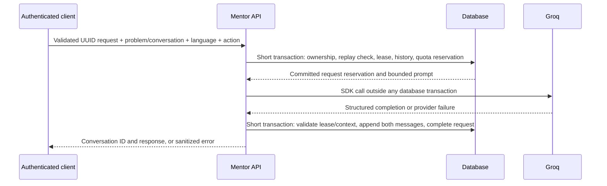

# Phase 5: backend AI coding mentor

## Architecture

`ai_engine` is a Django app using the existing standard User model, Problem, Conversation, Message, JWT defaults, bounded JSON parser, and private conversation service. Dependencies add only the official Groq Python SDK (1.7.0, plus its transitive dependencies).

| Module | Responsibility |
| --- | --- |
| `serializers.py` | Strict request schema, language/action/level validation, combined message limit |
| `prompts.py` | Teaching policy, untrusted problem context, bounded chronological history |
| `provider.py` | SDK communication, timeouts, structured-response validation, sanitized provider errors |
| `services.py` | Owned conversation resolution, idempotency, lease reservation, orchestration, atomic completion/failure |
| `usage.py` | Persisted UTC daily attempt quota |
| `models.py` | Daily counters, request outcomes, per-conversation leases |
| `errors.py` | Fixed public error messages and internal provider error codes |
| `views.py` / `urls.py` | Authenticated `/api/hints/` and `/api/chat/` |

Problem reuse previously lived in a view rather than a service. It is now extracted into `problems/services.py` and reused by both APIs; shared metadata still cannot be overwritten through a submission.

## Lifecycle



The first operation in each short state-changing transaction is a no-op UPDATE of the owner's `last_login` column. It acquires a SQLite write lock or PostgreSQL row lock without changing last-login data, serializing a user's quota/idempotency decisions. A conditional database increment enforces the daily quota. Unique constraints enforce one counter per user/day, one request UUID per user, and one active lease per conversation. This stays compatible with initial SQLite development without relying on SQLite's unsupported row-level `select_for_update` behavior.

Requests to different conversations can perform network calls concurrently; same-conversation overlap returns `409`. History and `last_sequence` are captured during reservation. Before completion, the parent conversation is locked and the sequence rechecked. If another trusted service appended in the meantime, this response is discarded (`context_changed`). Deletion during generation discards the response. Stale leases are expired lazily by the next relevant request; late workers are fenced by request status and lease ownership/expiry. No background queue or long database/network transaction is introduced.

The models and locks have been tested with SQLite and controlled overlapping requests, not a PostgreSQL deployment or a high-load multi-process benchmark. SQLite can still return busy/lock errors, mapped to `503` rather than a false success.

## Request schema

Both endpoints require a valid Bearer access JWT and JSON. The existing 65,536-byte request limit applies.

Common fields:

- `request_id`: required UUID. Generate once per logical turn and retain it across network retries.
- `language`: required exact existing language choice, e.g. `Python`, `Java`, `C++`.
- `conversation_id`: optional positive ID or null. It must belong to the caller.
- `problem_id`: optional existing positive problem ID.
- `problem`: optional `{title, url, statement}` using the existing validated problem serializer.
- `user_thought`: optional thought/question, up to 6,000 characters, whitespace preserved.
- `code`: optional code, up to 6,000 characters, whitespace preserved.

A new conversation requires either `problem_id` or `problem`, never both. An existing conversation may omit problem identity; supplied identity and language must match. The stored action label, thought, and code combined must fit the existing 8,000-character message limit. Statement/title limits remain 30,000/255 characters. Client-supplied roles, ownership, provider credentials/model IDs, and arbitrary message arrays are rejected.

`POST /api/hints/` additionally requires `hint_level`:

| Level | Policy |
| --- | --- |
| 1 | Conceptual question/guidance, no algorithm reveal or code |
| 2 | Relevant algorithm/data structure and reasoning, no code/full solution |
| 3 | Approach and pseudocode, no complete executable solution |
| 4 | Explicit complete solution, explanation, time and space complexity |

`POST /api/chat/` uses `action`: `discuss` (default), `debug`, `explain`, or `solution`. A thought/question or code is required unless explicitly requesting `solution`. Debug/explain focus on the submitted reasoning/code; they do not implicitly request a full solution. Hints may omit a thought when asking for initial guidance.

## Prompts and output policy

System instructions contain only trusted mentor policy. Problem metadata is JSON in a user-role context message, followed by stored history in chronological order, then the current user request once. Historical complete solutions do not grant permission to reveal another solution on an earlier hint level.

Existing history message/character ceilings apply. Total prompt content characters (including system/problem/current turn) are capped separately; remaining space determines the history budget. Oversized fixed context returns `400` before quota/request reservation commits. No previous messages are deleted by context truncation. Character budgets are deterministic size controls, not exact tokenizer counts; message framing and model reasoning need additional token-aware budgeting later.

The provider must return JSON with exactly `response` (nonempty string) and `contains_full_solution` (boolean). The API exposes only response text, not private reasoning. Validation rejects malformed JSON/shapes, empty/oversized/NUL-containing content, tool-call responses, non-stop/truncated completions, and accidental literal signing-provider-key echo. Full solutions are rejected unless explicitly permitted. Early hints reject code fences; level 3 permits only labeled pseudocode/text fences. Common executable-code signatures are also rejected without explicit solution permission. These are conservative checks, not a proof that prose cannot reveal an answer or that prompt injection is impossible. Model-quality/manual evaluation is still required.

## Provider configuration

Add a real `GROQ_API_KEY` only to ignored `backend/.env` or a backend process environment. No actual key is committed or printed by setup/tests. Missing/placeholder keys cause sanitized `503` responses only for AI requests; other APIs still work.

| Environment variable | Default |
| --- | --- |
| `GROQ_API_KEY` | Empty; required for real AI calls |
| `GROQ_MODEL` | `openai/gpt-oss-120b` |
| `GROQ_REASONING_EFFORT` | `medium`; accepts low/medium/high, sent only for GPT-OSS models |
| `GROQ_TIMEOUT_SECONDS` | 25 |
| `GROQ_MAX_COMPLETION_TOKENS` | 4096 |
| `AI_REQUEST_RATE` | 10/minute per user, shared across both endpoints |
| `AI_DAILY_REQUEST_LIMIT` | 50 reserved attempts per user per UTC day |
| `AI_MAX_PROMPT_CHARACTERS` | 60,000 |
| `AI_LEASE_SECONDS` | 120; must exceed the configured SDK timeout |
| `HISTORY_MAX_MESSAGES` / `HISTORY_MAX_CHARACTERS` | Existing defaults: 20 / 24,000 |

The model is an environment setting, not client-selectable. Confirm your account's model permissions and current [Groq production models](https://console.groq.com/docs/models). The default supports JSON object mode. A replacement model must support chat completions, JSON object responses, and the configured token/temperature parameters. Changing model IDs does not automatically translate incompatible capabilities.

For GPT-OSS 120B/20B, the client explicitly sends `include_reasoning=False` and the configured reasoning effort, without `reasoning_format` (unsupported for these models). Reasoning still consumes completion tokens even though it is excluded from the returned payload. The default completion budget is 4096 with medium reasoning effort, giving contextual answers more room than the former 2048/low configuration; this can increase latency and provider token usage. Evaluate against the extension timeout. Truncated output is never treated as a successful answer. These options are omitted for unrelated models. See [Groq's GPT-OSS reasoning documentation](https://console.groq.com/docs/reasoning).

### Resolving old-model availability errors

Groq's [deprecation notice](https://console.groq.com/docs/deprecations) lists August 16, 2026 for Llama 3.3 70B and recommends GPT-OSS 120B as a replacement. The current Django default already uses `openai/gpt-oss-120b`. A process environment variable overrides the saved `.env`; a server that has not restarted or an older extension installation may still use its old configuration.

Save `GROQ_MODEL=openai/gpt-oss-120b` and optionally `GROQ_REASONING_EFFORT=medium` in ignored `backend/.env`. Leave all credentials untouched. Stop Django with Ctrl+C. In that server's PowerShell terminal, clear an obsolete override and verify the effective model before restarting:

```powershell
Set-Location 'C:\Users\Shivangi Ahuja\Desktop\Student Buddy\backend'
Remove-Item Env:GROQ_MODEL -ErrorAction SilentlyContinue
.\.venv\Scripts\python.exe manage.py shell -c "from django.conf import settings; print(settings.GROQ_MODEL)"
.\.venv\Scripts\python.exe manage.py runserver 127.0.0.1:8000
```

Only the model name is printed. Never print the key or all settings. Use a fresh logical request UUID when testing after a configuration fix: idempotency deliberately replays an old failed request's error. Reload the extension at `chrome://extensions/` if necessary; no extension/API changes are required for this fix. Model access remains account-dependent, so a real provider check must be performed separately. Mocked tests verify default/environment/reserved model selection, reasoning options, JSON format, truncation rejection, and sanitized model errors without a live API call.

The [official Groq SDK](https://github.com/groq/groq-python) is used rather than maintaining custom authentication/HTTP plumbing. SDK retries are explicitly disabled: one quota reservation does not silently trigger multiple SDK retries. Timeouts bound SDK network operations; they are not a strict end-to-end deadline against a slowly trickling response. The lease prevents expired work from committing. No tools are requested and no code is executed. Raise completion limits carefully if the model runs out of reasoning/output tokens; a `length` finish is rejected rather than saved as a complete answer.

Provider exception bodies are never returned or logged by application code. Timeouts, HTTP/network errors, malformed responses, provider limits, and unavailable models map to fixed messages. HTTP 400/404/422 model/config errors return `model_unavailable`; 401/403/5xx map to generic provider unavailability. Do not enable SDK/HTTP wire debugging, request-body logging, or Authorization-header logging in production.

## Persistence, quotas, and retries

- `DailyUsage` stores `(owner, UTC day, reserved attempts)` independently of cache/process lifetime. Reservations include failed calls, crashes, and discarded stale results. Validation/configuration/ownership rejection before reservation does not charge a request.
- `MentorRequest` stores the user UUID, validated-input fingerprint, state, associated conversation and assistant message, requested model, optional provider token counts, and timestamps. It stores no raw credentials or duplicate prompt/response blobs.
- `ConversationLease` links one active generation to a conversation with an expiry.

On success, both messages are appended through the existing conversation service and the request marked succeeded in the same transaction. The user message records the requested action/level, thought, and optional code. There is no partial user/assistant turn on success.

On provider failure, neither user nor assistant message is saved. A new conversation remains empty and the error includes its ID when available. The failed request remains recorded and consumes its reserved daily attempt. This prevents failed user turns from silently appearing in future context without an assistant response. The client must retain the draft for retry.

Retry semantics:

| Situation | Same request ID + identical validated input |
| --- | --- |
| Success, response lost | Return stored response; no provider call or additional quota |
| Provider failure | Return same sanitized failure; no additional quota |
| Still processing | `409 in_progress`; wait/retry |
| Worker crashed, lease expired | Mark failed; `409 request_expired`; new attempt needs a new ID |
| Same ID with changed input | `409 request_conflict` |
| Conversation deleted after success | `410 conversation_deleted`; no replay of deleted content |

Changing endpoint semantics or fields requires a new request ID. Keep the same request body on uncertain network/storage retries. A local storage failure after the provider returns may leave a pending request with no saved messages; repeated retries do not call the provider again. It expires lazily, after which the client may explicitly initiate a new attempt. This is local idempotency, not exactly-once provider billing: a crash after Groq accepts a call cannot undo that charge.

Daily limits reset at midnight UTC (05:30 in Asia/Calcutta). Per-minute DRF throttles remain per-process local-memory checks; deploy a shared cache plus infrastructure-level limits before production. Persistent daily quotas count requests, not monetary spend or total tokens, and do not prevent abuse through many accounts. Failed completions do not always provide trustworthy token usage. Counter/request retention and cleanup need a future policy; no records are silently pruned here.

## API examples

Hint request for a new conversation:

```json
{
  "request_id": "ed282065-f942-47e3-aed0-cbf340ee334e",
  "problem_id": 1,
  "language": "Python",
  "hint_level": 1,
  "user_thought": "I am thinking of a hashmap. What should it store?"
}
```

Response:

```json
{
  "request_id": "ed282065-f942-47e3-aed0-cbf340ee334e",
  "conversation_id": 15,
  "response": "Which information would let you find the complement and its index efficiently?",
  "hint_level": 1
}
```

Continue via chat:

```json
{
  "request_id": "c6c66d0f-127d-437f-aa36-47bf150d1f36",
  "conversation_id": 15,
  "language": "Python",
  "action": "debug",
  "user_thought": "Why does insertion before the lookup cause trouble?",
  "code": "seen[number] = index"
}
```

Use real IDs from your own API responses; sample IDs are illustrative. In Postman, log in first, set Bearer authentication to the access token, choose raw JSON, and generate a fresh UUID for each new logical turn. Keep the same UUID/body when repeating an uncertain request.

Error responses contain a sanitized `code` and `message` (plus `conversation_id` when available). Statuses include `400` validation/budget errors, `401` invalid authentication, `404` unowned/missing conversations, `409` request/lease/context conflicts, `410` deletion, `413` oversized bodies, `429` throttles/daily quota, `502` provider/invalid output, `503` unavailable service/provider limits/storage, and `504` timeout. Rejected errors never contain raw provider messages or keys.

## Windows verification

```powershell
Set-Location 'C:\Users\Shivangi Ahuja\Desktop\Student Buddy\backend'
.\.venv\Scripts\python.exe -m pip install -r requirements.txt
.\.venv\Scripts\python.exe manage.py migrate
.\.venv\Scripts\python.exe manage.py check
.\.venv\Scripts\python.exe manage.py makemigrations --check --dry-run
.\.venv\Scripts\python.exe manage.py test --verbosity 2
.\.venv\Scripts\python.exe manage.py runserver 127.0.0.1:8000
```

All automated AI tests mock the provider or SDK. A real key is not needed for tests. The main README includes login and full PowerShell hint/chat examples. Add a key locally and restart the server only if you want to perform a real provider check; manual requests consume quota and provider usage. No live provider/browser verification is claimed by this phase.

Tests include four hint policies, chat/debug/explain/solution actions, canonical problem reuse and new conversation creation, chronological bounded context, isolation and consistency, strict validation/body limits, sanitized provider error classes, malformed/truncated responses, policy gates, quota/cache/day behavior, replay/conflict/failure semantics, expired leases, stale writes, deletion, atomic pair rollback, and an explicit assertion that the network call runs outside database transactions. Existing authentication, problem, conversation, health, and extension tests remain intact.

## Security limitations and Phase 6

Model output is untrusted. Safe frontend rendering must remain in place. Problem text and student code are sent to Groq in real requests; provider privacy/retention and user consent need review before release. Prompt instructions and response checks reduce risk but do not guarantee code correctness or prevent all semantic answer leaks. No generated code runs on the server.

PostgreSQL/high-load testing, token-aware budgeting, retries/backoff policy, per-account abuse controls, usage reporting, retention, and model-quality evaluations remain future work. The current synchronous API holds a web worker while waiting on Groq; it does not hold a database transaction. Existing authentication caveats (access tokens valid until expiry, email verification/MFA absent, cache throttles) still apply.

Phase 6 should integrate extension JWT login/refresh/logout, preserve its mentor panel, route actions through these APIs, retain request UUIDs across retries, handle quota/conflict errors, and map current problem/language IDs consistently. Keep refresh tokens out of content scripts/page DOM. Remove legacy frontend Groq calls, host permissions, and stored keys only when the authenticated backend path replaces them. Configure HTTPS and narrowly scoped extension/backend access before production. No extension changes or deployment are part of Phase 5.


### Contextual JSON-generation failures

The provider uses strict `json_schema` output for GPT-OSS 120B/20B, retaining the existing response/contains_full_solution contract and all local validation. Other models retain JSON object mode. See [Groq structured outputs](https://console.groq.com/docs/structured-outputs).

A Groq HTTP 400 `json_validate_failed` is a formatting failure, not an unavailable model. Only explicit model errors (or 404) map to model_unavailable. Raw provider bodies, generated failures, prompts and secrets are never sent to clients or logged. Even strict output can be rejected upstream in live requests: the backend retries a definitive HTTP 400 JSON-generation rejection **once**, with the same prompt/options, within the same logical usage reservation. SDK retries remain disabled. There is no automatic retry for timeouts, network errors, rate limits, credentials, unavailable models, or rejected local safety checks. One logical request can therefore incur up to two provider calls and additional latency/token cost; bounded by two SDK timeouts rather than one. A client timeout still requires retrying the same UUID to recover the result safely. No partial output is persisted.

Defaults and `.env.example` now use `GROQ_REASONING_EFFORT=medium` and `GROQ_MAX_COMPLETION_TOKENS=4096`. Update an existing ignored `.env` and restart Django for these values to take effect. A failed UUID replays its saved failure: send a new logical question to try again after configuration fixes. Approach feedback does not authorize a full solution; use the explicit complete-solution control.
