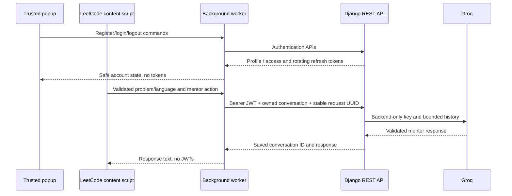

# Phase 6: Chrome extension and Django integration

## Scope and architecture

The existing Manifest V3 extension and floating panel are retained. No React, new UI framework, backend route changes, deployment, commits, or pushes are introduced. Groq runs exclusively through the existing Django AI engine. Earlier phase notes remain historical records; their descriptions of direct extension Groq calls no longer describe the current extension.



| File | Responsibility |
| --- | --- |
| `config.js` | Reviewed public backend origin and 28-second client timeout |
| `api-client.js` | Credential migration, trusted storage, login/profile/logout, refresh single-flight, sanitized HTTP errors |
| `mentor-client.js` | Validated context, per-user/problem/language ID mapping, history recovery, idempotent request bodies, new/delete semantics |
| `background.js` | Imports local modules, validates message senders/commands, routes safe operations, broadcasts auth changes |
| `popup.html` / `popup.js` | Login/registration/account display and explicit panel actions; no provider key form |
| `content.js` / `styles.css` | Preserved floating UI, safe DOM rendering, LeetCode extraction, action mapping, stale-response guards |
| `manifest.json` | MV3, Chrome 114+, storage/activeTab, loopback host permission, restrictive worker/page CSP |
| `tests/worker-harness.cjs` | Mock Chrome storage/messaging and network harness |
| `tests/extension*.test.cjs` | UI/worker/HTTP-client regression and integration tests |
| `core/test_extension_contract.py` and `tests/backend-contract-client.cjs` | Isolated Django HTTP contract using the extension worker client and mocked provider |

The three old worker paths (`handleMentorRequest`, `handleSolutionRequest`, `handleCorrectionRequest`) and their Groq URL/prompt/client code are removed. New worker commands map those UI actions to `/api/hints/` or `/api/chat/`. Existing backend APIs, migrations, authentication, AI engine, and model contracts remain unchanged.

## Authentication and storage

Registration sends username/email/password/confirmation to Django, then asks the user to log in. Login obtains tokens and fetches `/api/auth/profile/`. Password fields are cleared immediately after submission; credentials are transient memory only. The popup receives user ID/username, never tokens.

| Data | Storage / visibility |
| --- | --- |
| Access and refresh token pair, user ID/username, auth epoch, backend origin | One `sbAuth` object in trusted-only `chrome.storage.session`; worker memory while running |
| Conversation ID and generation marker | `chrome.storage.local`, restricted to trusted contexts; keyed by backend/user/problem/language |
| Pending request UUID, exact body, action signature | Trusted session storage only, so page/worker restarts can retry the same action |
| Passwords | Never stored |
| Groq credentials | Backend environment only; never requested by the extension |
| Rendered history | Page DOM while displayed; source of truth is Django |

Chrome session storage is memory-backed and survives service-worker suspension, unlike plain JavaScript globals. It does not intentionally persist sign-in across browser restarts, disabling, or extension reload/update. The extension also explicitly calls `setAccessLevel(TRUSTED_CONTEXTS)` on session and local areas before using them. See [Chrome storage documentation](https://developer.chrome.com/docs/extensions/reference/api/storage). These controls are not encryption or protection from a compromised browser, OS, extension debugger, or trusted extension code. Browser crash reports/swap and profile backups are outside the extension's control.

Access expiry is checked locally with a small safety margin; the backend remains the authority for signature/validity. A protected request returning `401` refreshes and retries its exact body once. Concurrent requests share a single refresh promise and save the rotated pair together. An invalid or lost/ambiguous refresh response clears authentication rather than repeatedly submitting a potentially consumed token. The user logs in again. Backend-connection failures with a still-valid access token preserve the session; failures during refresh deliberately fail closed.

Auth epochs prevent an old refresh/AI response from restoring a logged-out or different account. Login/logout mutations are serialized. Logout invalidates the UI, waits for any active rotation, tries to obtain usable logout credentials, clears local auth/pending drafts, and attempts to blacklist the latest refresh token. If offline, the popup says server revocation is unconfirmed. Already-issued access tokens still expire normally; other sessions are unaffected. A storage-clear failure is reported explicitly rather than claiming successful sign-out.

Startup removes the old `apiKey` entry from sync/local/session without reading it. Failure blocks API use and asks the user to reload/fix storage. No migration transmits the old key. The extension can remove data only for its own extension ID; uninstall a separate old root-folder installation to remove its separate storage. Revoke/rotate a previously synced legacy key in Groq's console as part of migration, then configure the backend key privately.

## Permissions, origins, and message boundary

Local development uses exactly `http://127.0.0.1:8000`. `host_permissions` is `http://127.0.0.1/*` (Chrome host patterns include the path wildcard); application configuration and `connect-src` pin the actual origin/port to 8000. No wildcard hostname, Groq host permission, remote script, externally-connectable bridge, or content-script fetch proxy is introduced. Credentials are sent as Authorization headers, never URL parameters. Cookies are omitted and redirects rejected.

Only the exact extension popup URL or the top-level extension-owned `auth.html` page may submit registration/login credentials. The floating panel may request that fixed account page, retrieve username-only account state, or invoke logout; it cannot submit passwords or request tokens. Mentor messages require the same extension ID, top frame, a supported HTTPS LeetCode problem page, and a problem URL matching the sender's current problem. Unknown fields/commands, arbitrary URLs/tokens/conversation IDs, unrelated senders, and child frames are rejected. The worker selects all backend paths and stored conversation IDs itself. No `window.postMessage` or DOM event bridge exposes tokens. Browser-generated interaction checks on mentor controls reject synthetic page-script clicks; page DOM remains an untrusted surface.

Worker cross-origin fetch with host permissions is supported without enabling backend wildcard CORS. Content scripts never fetch the backend themselves. See [Chrome cross-origin request guidance](https://developer.chrome.com/docs/extensions/develop/concepts/network-requests). Existing Django allowed-host/JWT checks remain. No CORS package or origin reflection is added. CORS is not an authentication boundary and does not stop arbitrary nonbrowser HTTP clients.

For production later, change three reviewed build-time settings together: `config.js` to the specific HTTPS backend origin, the manifest host permission to that exact hostname, and `content_security_policy.extension_pages.connect-src` to that HTTPS origin. Configure Django allowed hosts/HTTPS securely. Reload the extension and reauthenticate; stored tokens from a different backend origin are discarded. Do not accept a production URL from the LeetCode page or an unrestricted settings input. Nothing is deployed in this phase.

## Mentor actions and persistence

| UI action | Backend request |
| --- | --- |
| First Hint | `/api/hints/`, level 1 |
| Stronger Hint | `/api/hints/`, level 2 |
| Direct Nudge | `/api/hints/`, level 3 |
| Show Complete Solution | Explicit confirmation, `/api/hints/`, level 4 |
| Send Thought / approach feedback | `/api/chat/`, `action=discuss` |
| Debug my code | `/api/chat/`, `action=debug`, current extracted code |
| Explain my code | `/api/chat/`, `action=explain`, current extracted code |
| Wrong Answer / Describe the Issue | Explicit correction action, `/api/chat/`, `action=solution`, previous solution in saved context |

Original hint labels and the three-successful-hints solution unlock remain. Complete solutions request explanation and time/space complexity and ask to preserve the supplied LeetCode signature. Correction buttons appear on explicitly requested solution responses, including recovered ones. Code blocks/copy behavior and safe text-node rendering are retained. No untrusted HTML is parsed.

The first turn sends nested `{title, url, statement}`, language, action, and a fresh UUID. Later turns send the stored conversation ID with the same language. The backend revalidates owner and context and persists messages. URL queries/page tabs do not split canonical problem identity. A manual language selection is not overwritten by automatic detection. Automatic language changes, manual changes, and LeetCode route changes clear current UI state and recover the corresponding mapping.

Problem extraction waits for a usable title and statement; it no longer silently truncates to 1,500 characters. The existing backend statement/title limits apply. On SPA navigation it waits for old metadata to change; title links, when present, must match the new slug. Missing/oversized/changed data blocks generation with a clear status. This remains DOM-based, and LeetCode markup changes can still require selector maintenance. Monaco extraction uses visible DOM lines and may not capture the entire editor; verify copied/generated code manually.

Panel/page/worker reopening recovers the latest 50 messages through the bounded conversation-detail API, verifies increasing sequence order and context, and displays a truncation notice if needed. Full server history remains accessible through the existing paginated endpoint. This MVP resumes the most recently mapped conversation for each user/problem/language; it does not add a full conversation picker. Auth tokens are browser-session-only, but local IDs survive; logging back in as the same user can recover them. Another user receives separate keys and server ownership checks.

### Clear, new, delete

- **Clear visible panel:** reset displayed messages, draft, UI progress, and display version. Keep the conversation ID and all server messages. A refresh/Reload history restores them. A request already accepted by Django may still finish/save; its late response is not rendered into the cleared panel.
- **Start a new conversation:** invalidate the current generation marker, remove its pending draft, and detach the saved ID. Preserve the old server conversation. The next mentor action creates a new conversation. An older in-flight reply cannot attach its ID or messages to the new UI context.
- **Delete saved conversation:** popup confirmation is required, then call DELETE for the owned mapped conversation. Network failures do not claim a confirmed deletion. If a first request is still uncertain and its conversation ID is unknown, resolve/retry it before deletion; the extension does not pretend it can delete an unknown ID. No-ID/no-pending deletion reports that there is nothing to delete.

An unavailable/deleted mapping is cleared after backend `404`; no paid AI action is silently retried as a new conversation. Explicitly choose a new action or start new.

### Retry and stale responses

Persist the exact body/UUID in session storage before issuing an AI fetch. Network disconnects, extension timeouts, in-progress conflicts, and ambiguous storage errors retain it. Retry request uses that same logical action. Changed drafts cannot replace an uncertain action; the original action is offered for retry. Recovery after a page/worker restart restores the pending action too. A definitive provider failure consumes its backend quota as before; a later intentional action receives a new UUID.

Login/logout, extension reload, or browser-session termination discard pending session drafts; exact retry continuity does not extend past those boundaries. Inspect saved history after signing back in before resubmitting an uncertain action. New and clear operations cannot cancel provider work that Django already accepted; provider usage may still occur.

Content display versions and immediate URL/language checks suppress stale renderings, including the interval before SPA polling detects a route change. Worker auth epochs and context-generation checks prevent old replies from updating another user's mapping or a new conversation. Simultaneous identical-context calls are rejected locally while one is active; backend leases/idempotency remain the final cross-worker authority.

The client uses a 28-second timeout because Chrome can terminate a service worker when a fetch response takes over 30 seconds to arrive. See [MV3 lifecycle limits](https://developer.chrome.com/docs/extensions/develop/concepts/service-workers/lifecycle). SDK network-operation timeouts are not hard overall deadlines, so long model responses can still exceed this window. Stable UUID retry handles uncertain responses; production may need asynchronous job submission/polling rather than longer synchronous timeouts.

## Local setup and automated verification

Use an existing valid `backend/.env` with Django/JWT secrets. For real AI calls add `GROQ_API_KEY` and a supported `GROQ_MODEL` there only; follow Phase 5 configuration. No Groq key is required for automated tests. No Phase 6 backend production changes or migrations are needed beyond ensuring the existing migrations are applied.

```powershell
Set-Location 'C:\Users\Shivangi Ahuja\Desktop\Student Buddy'
git status
git diff --check
git check-ignore backend/.env backend/db.sqlite3 backend/.venv/pyvenv.cfg
git ls-files backend/.env backend/db.sqlite3 backend/.venv
node --test tests/extension.test.cjs tests/extension-integration.test.cjs
Set-Location .\backend
.\.venv\Scripts\python.exe -m pip install -r requirements.txt
.\.venv\Scripts\python.exe manage.py migrate
.\.venv\Scripts\python.exe manage.py check
.\.venv\Scripts\python.exe manage.py test --verbosity 2
.\.venv\Scripts\python.exe manage.py runserver 127.0.0.1:8000
```

`git ls-files` for the secret/local paths must print nothing. `.env.example` stays trackable and contains placeholders only. Node.js 18+ runs the tests; Django's HTTP contract test is explicitly skipped if Node is absent. Call the virtual-environment Python directly so PowerShell activation-policy changes are unnecessary.

Automated Node tests mock Chrome/network behavior, including registration/login/logout, refresh rotation/single-flight, migration, permissions/sender validation, API schemas, errors, all hint levels and chat modes, persistent IDs, history, retries, problem/user switches, and stale replies. Existing safe rendering, clipboard, history clearing, language, and manifest tests remain; obsolete extension-to-Groq tests are adapted to the replacement backend client while retaining malformed-response/network/timeout coverage.

The additional Django LiveServer test runs the real worker client against real loopback Django HTTP routes with an isolated database and mocked Groq. It verifies registration/login, new and continued AI turns, chronological recovery, and logout. It does not load Chrome, test real browser host permissions/CSP, inspect LeetCode, or contact live Groq. Do not interpret any automated test as completion of the following manual checklist.

Implementation verification: 75 backend tests (including the HTTP contract) and 38 extension tests passed. JavaScript syntax, Django checks, migration consistency, Git whitespace, and PowerShell example parsing were also checked. No actual Chrome or live-Groq check was performed.

## Manual Chrome and live-provider checklist — pending

Record browser version, extension ID, model, date, and pass/fail notes privately. Do not capture tokens or keys in screenshots/network exports. These steps have **not** been performed by Codex.

1. **Start Django locally.** Run the commands above, configure the Groq key only in ignored `.env`, and confirm `http://127.0.0.1:8000/api/health/` returns JSON. Real model calls consume quota/provider usage.
2. **Load unpacked.** In Chrome 114+, open `chrome://extensions`, enable Developer mode, and load `C:\Users\Shivangi Ahuja\Desktop\Student Buddy\chrome-extension`. Reload an existing installation after changes. Remove a separate old root-directory installation to avoid duplicate panels and separate leftover credential storage.
3. **Register a test user.** Open the popup, choose Create an account, submit a new username/email/strong password with confirmation. Verify invalid/mismatched/duplicate inputs show readable errors and password fields clear. Verify no Groq key input exists.
4. **Log in.** Verify username display. Close/reopen the popup and suspend/restart the worker; the session should recover. Inspect storage only privately: passwords/Groq keys must not exist; tokens belong only in trusted session storage. Never copy token values into reports.
5. **Open LeetCode Two Sum.** Refresh the page, expand/minimize/drag the panel, use Ctrl+Shift+M, and verify title, statement extraction, language badge/dropdown. Test automatic detection, manual override, and switching back by refreshing.
6. **Generate each hint level.** Click First Hint, Stronger Hint, Direct Nudge. Verify levels 1/2/3 match policy and failed calls do not increment progress. After three successful hints, Show Complete Solution is available; test level 4 separately in step 8. Rapid overlapping clicks should not duplicate turns.
7. **Submit a thought.** Ask about hashmap contents and then refer to that earlier idea; verify contextual feedback and saved messages. Choose Debug my code and Explain my code with a small editor sample, verifying code extraction and appropriate responses.
8. **Request a complete solution explicitly.** Confirm the request and verify code language, function signature, explanation, time/space complexity, and clipboard indentation. Exercise Wrong Answer and Describe the Issue on a suitable test example. The model may still be wrong; no code is automatically executed or injected into the editor.
9. **Refresh LeetCode.** Confirm recent messages restore in sequence and the same conversation continues. Close/reopen the panel/popup. Change problem and language and verify histories do not mix. Navigate between problems without full reload and watch for stale titles or responses.
10. **Verify history semantics.** Clear panel: visible messages disappear, but refresh/Reload history restores them. New conversation: starts empty and old server history remains. Delete saved conversation: requires confirmation and only the current saved conversation disappears. Test deletion or a missing mapping while disconnected and check that the UI does not falsely claim success.
11. **Logout and log back in.** Logout clears UI/token state and late answers must not reappear. Same user can recover the mapped saved history on login. Close the browser completely/reload the extension: sign-in should be required again. No persistent password/refresh token should appear in local/sync storage.
12. **Verify ownership.** Register/log in as a second user on the same problem/language; no first-user messages or IDs should be reused. Return to the first user and recover their own history. Backend direct cross-user ID tests must still pass.
13. **Stop/restart Django.** Try a hint, restore the backend, and use Retry request. Confirm the same UUID/body is retried and a single saved turn appears. Reload the page during an uncertain request and recover Retry request. Test expired/deactivated/invalid refresh tokens and concurrent refresh attempts; invalid refresh signs out safely. Test daily quota/provider timeout/unavailable model with a development configuration and reset it afterward.
14. **Confirm provider removal.** In the extension service-worker Network panel, observe only the configured backend for authentication/mentor calls; no request to `api.groq.com` may originate from the extension. Inspect manifest permissions/CSP and startup key removal. The backend may call Groq. Google Fonts in the retained panel CSS are a separate existing external asset request.
15. **Exercise stale boundaries.** Start an AI request, then clear the panel, start new, switch languages/problems, or logout before completion. Old responses must not enter the new UI/context. If a server request already completed, its messages may exist in the old saved conversation; that is expected, not a reason to delete them automatically.

## Remaining risks and Phase 7

Tokens in trusted session storage are less persistent than local/sync tokens but are not HttpOnly cookies or a hardware-backed secret store. A compromised trusted extension context/browser can access them. The LeetCode page can see text rendered into its DOM; token isolation does not make displayed conversations private from the host page. Synthetic network-action clicks are rejected, but visual spoofing/UI redressing and malicious platform DOM remain concerns.

Offline logout cannot guarantee server revocation. Access tokens remain valid until expiry. Uncertain requests can still consume provider quota, and auth/session termination breaks retry continuity. UI recovery is limited to 50 recent messages, mapping selection to one current conversation per context, and current DOM/Monaco selectors. Local conversation mappings persist until extension removal or explicit actions; there is no added dashboard/history picker in this phase.

Backend limitations from Phase 5 remain: local-memory throttle, SQLite contention, character-based rather than token-exact budgets, semantic prompt/solution leaks, no complete model-quality guarantee, no email verification/MFA, and no PostgreSQL/high-load production validation. Review code/provider privacy and retention before release. Never enable debug/wire logs containing credentials or full problem/code content.

Phase 7 should execute and record the manual checklist, add browser automation against stable fixtures where useful, evaluate model behavior and LeetCode extraction, test PostgreSQL/shared caching, design async AI jobs if synchronous MV3 limits are problematic, and prepare production HTTPS/origin/CSP/privacy/store requirements. Deployment or publishing still needs separate explicit authorization.
